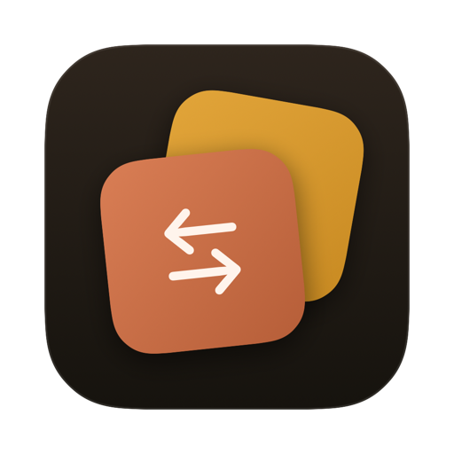
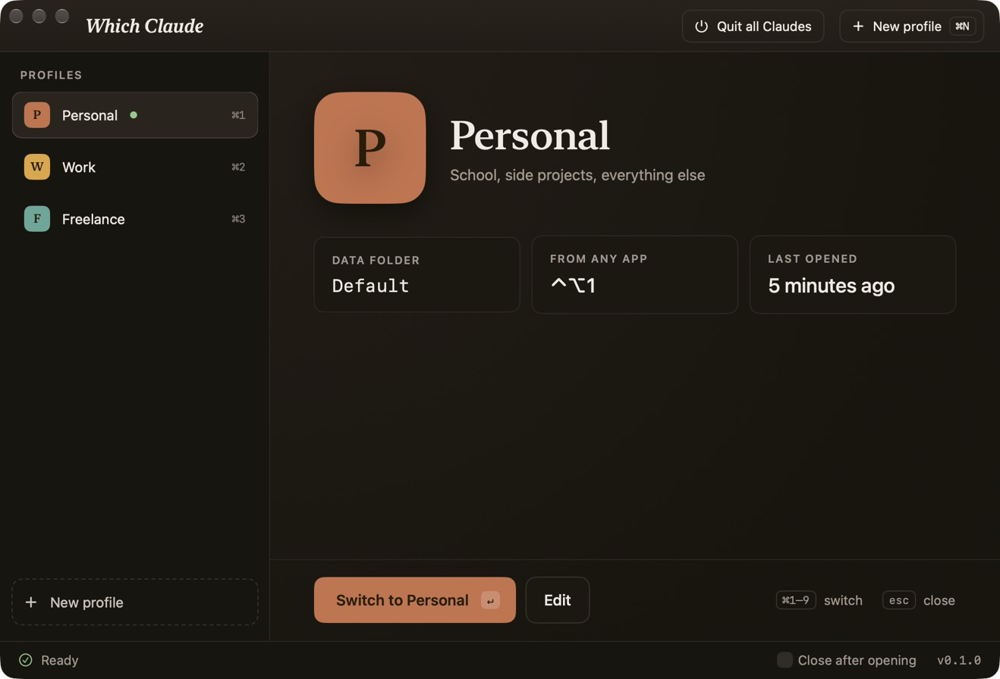
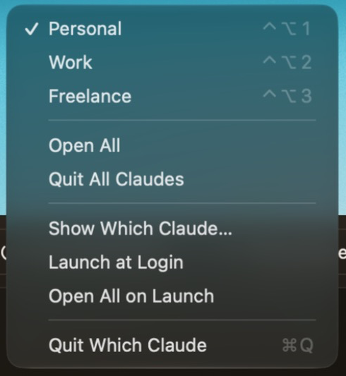
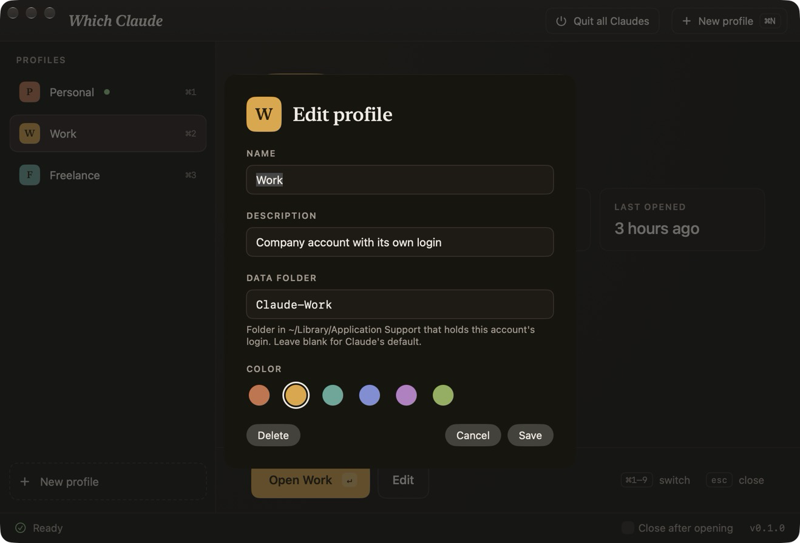

<div align="center">



# Which Claude

**Run more than one Claude account on your Mac, side by side, and switch between them with one keystroke.**




</div>

---

## Why

The Claude desktop app signs in to **one account at a time**. If you have a personal account and a work account, you either sign out and back in all day, or live in the browser.

Which Claude gives each account its own copy of Claude.app running at the same time, each with its own login, chats and settings. Pick one from the menu bar or press <kbd>⌃</kbd><kbd>⌥</kbd><kbd>1</kbd> from anywhere and it comes to the front.

## Features

- **Separate accounts at once.** Every profile gets its own Claude instance and its own data folder, so logins never collide.
- **Global shortcuts.** <kbd>⌃</kbd><kbd>⌥</kbd><kbd>1</kbd>–<kbd>9</kbd> opens or switches to a profile from any app. No Accessibility permission needed.
- **Menu bar menu.** See which accounts are running (✓), open one, open all, or quit them all.
- **No duplicates.** If a profile is already running, Which Claude switches to it instead of starting a second copy, even if you started it some other way.
- **Open All / Quit All.** Start your whole setup in one click, or shut every Claude down cleanly (same as <kbd>⌘</kbd><kbd>Q</kbd> in each).
- **Launch at login.** Optionally start Which Claude when you log in and open every profile with it.

<table>
  <tr>
    <td align="center" width="40%"><br><sub>Menu bar: ✓ means running</sub></td>
    <td align="center" width="60%"><br><sub>Each profile points at its own data folder</sub></td>
  </tr>
</table>

## Install

> **Prebuilt download coming soon** on the [Releases](../../releases) page. Until then, building it takes about a minute.

**You need:** macOS 15 or later, the [Claude desktop app](https://claude.ai/download) in `/Applications`, and Xcode 26 or later (free on the Mac App Store).

1. **Clone the repo**

   ```bash
   git clone https://github.com/armin-ahmadii/WhichClaude.git
   cd WhichClaude
   ```

2. **Build it**

   ```bash
   xcodebuild -project WhichClaude.xcodeproj -scheme WhichClaude -configuration Release -derivedDataPath build build
   ```

   Prefer Xcode? Open `WhichClaude.xcodeproj` and press <kbd>⌘</kbd><kbd>R</kbd>.

3. **Move it to Applications and open it**

   ```bash
   cp -R build/Build/Products/Release/WhichClaude.app /Applications/
   open /Applications/WhichClaude.app
   ```

   It needs to live in `/Applications` for **Launch at Login** to work.

## Set up your accounts

Which Claude starts with two profiles: **Personal** (Claude's normal data folder) and **Work** (a folder called `Claude-Work`).

1. Leave **Personal** as is. It's the account you're already signed in to.
2. Select **Work** and press **Open**. A fresh Claude window appears.
3. Sign in to your second account in that window. You only do this once; the login is saved in its own folder.

Want a third account? Click **New profile**, give it a name and a new data folder (for example `Claude-Freelance`), open it, and sign in.

> **Already use a terminal alias** like `open -n -a Claude --args --user-data-dir=...`? Point a profile at the same folder name and Which Claude will pick up that account, running or not.

## Shortcuts

| Shortcut | Where | Does |
| --- | --- | --- |
| <kbd>⌃</kbd><kbd>⌥</kbd><kbd>1</kbd>–<kbd>9</kbd> | Anywhere | Open or switch to profile 1–9 |
| <kbd>⌘</kbd><kbd>1</kbd>–<kbd>9</kbd> | Which Claude window | Select a profile |
| <kbd>↵</kbd> | Which Claude window | Open the selected profile |
| <kbd>⌘</kbd><kbd>E</kbd> | Which Claude window | Edit the selected profile |
| <kbd>⌘</kbd><kbd>N</kbd> | Which Claude window | New profile |
| <kbd>esc</kbd> | Which Claude window | Close the window (the app stays in the menu bar) |

## How it works

Claude.app is an Electron app, and Electron accepts a `--user-data-dir` flag that decides where it keeps its login, chats and settings. Which Claude launches a **new instance** of Claude.app for each profile with:

```
--user-data-dir=~/Library/Application Support/<data folder>
```

A blank data folder means Claude's default (`~/Library/Application Support/Claude`). To tell instances apart, Which Claude reads each running Claude's launch arguments, which is how it knows what's running and avoids starting duplicates.

The whole app is one Swift file: [`WhichClaude.swift`](WhichClaude.swift).

## Good to know

- **Same Dock icon.** Every instance is the same Claude.app, so they share one icon in the Dock. macOS doesn't let another app change that. Use the ✓ marks in the menu bar to see which accounts are running.
- **Shortcut clash?** <kbd>⌃</kbd><kbd>⌥</kbd> + number is rarely used, but if another app already uses it, that app may get it first.
- **Signing out.** To remove an account, delete its profile and then its folder in `~/Library/Application Support`.
- **No App Sandbox.** The sandbox blocks the launch arguments this app depends on, so it's built without it.

## Disclaimer

Which Claude is an independent project. It is not made by, affiliated with, or endorsed by Anthropic. Claude is a trademark of Anthropic.
